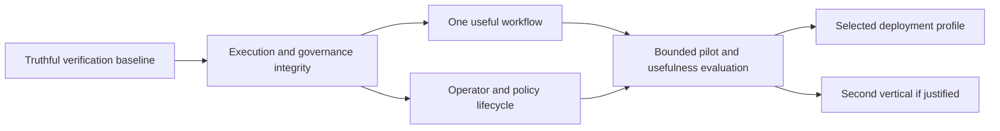

# MAESTRO next development stage — proposed design

Date: 24 October 2026. Status: proposed; analysis and plans are the deliverables
of this task. Product implementation has not been authorized by this document.
Baseline: `fb1425235417879e1af227e691a3676ccedd68c0`.

## Intent

Turn the existing enforcement framework into a verifiable tool for an operator
reviewing one bounded agent workflow. Preserve the Python modular monolith and
offline default. Make the result observable: a real artifact, an independently
checked outcome, and a decision record describing the exact authority used.

The audit in `docs/audit/2026-10-24-development-analysis.md` is the problem
statement. The immediate scope is M0, a truthful verification baseline. Later
milestones below are proposed projects with explicit gates; they are not all
part of one implementation sprint.

## Goals, constraints and anti-goals

- Preserve existing enforcement and quarantine behavior; do not disable gates
  to make a demo complete.
- Python 3.10 remains the declared minimum; preserve support for Python 3.11.
- Default validation must work offline without credentials, raw-packet replay,
  containers, database servers, or paid model calls.
- No simulation result may authorize production admission or be described as
  evidence of a real external effect.
- Every external mutation requires a stable operation identity and a bound
  proposal digest; ambiguous completion must not be retried blindly.
- Do not change dependencies, public APIs, or runtime enforcement in M0.
- Build in place. No new framework, microservice split, model training, public
  marketplace, billing, or broad agent framework integration in this stage.
- Compliance exports are evidence packages, not proof of SOC2/ISO certification.
- Never use total test count or zero ledger violations as a substitute for task
  usefulness, infrastructure validation, or attack success measurements.

## Development roadmap

Effort is an engineering planning range for one experienced contributor after
scope is agreed, not a delivery commitment. Integration availability can change
it. Do not run the whole roadmap under a single “complete” checkbox.

| Milestone | Scope and deliverable | Dependency / exit gate | Planning range |
|---|---|---|---|
| **M0: honest verification baseline** | One non-overlapping offline validation command, actual CLI smoke checks, machine-readable evidence manifest, corrected status matrix, fresh lint/types/tests recorded | No excluded offline auth/tenant/adversarial suites; failures propagate; current failures documented with exact commands; simulation/infrastructure shown separately | 2–4 days |
| **M1: execution and governance integrity** | Real release-evidence validation; signing extension repaired or unavailable; tenant containment admission guard; operation identity and safe retry contract; truthful backup verification/restore | F01/F04–F09 negative cases pinned; no false verified/succeeded state; no mutation on expired/digest-mismatched authorization | 2–4 weeks, split into independent changes |
| **M2: one complete workflow** | Proposed SOC review → approved, bounded sandbox action with observed receipt; local replay/incident evidence bundle | M1; normal task succeeds; injected/out-of-scope/expired approval denied; restart and partition exercised | 1–2 weeks |
| **M3: operator and policy lifecycle** | Authenticated console, approval inbox, meaningful diff/activation/rollback via API/SDK/CLI, retained run history | M1; backend truth tests plus browser acceptance with viewer/operator/admin roles | 1–2 weeks |
| **M4: real deployment profiles** | Separate self-hosted Postgres/OIDC/container profile and, if needed, hybrid lease client; signed deployment manifest | Live Linux/Postgres/identity/partition evidence; a profile cannot pass if required infrastructure is skipped | 3–5 weeks per selected profile |
| **M5: evaluate a second vertical** | Coding local patch workflow or research report workflow, chosen from user demand | Useful-task baseline and new trust boundary defined; independent domain verifier and actual artifact | Scope after pilot evidence |

M1 tasks need not all ship together. Release/signing, operation journal/retry,
backup/restore, and tenant containment are separate reviewable work packages.
Do not introduce production external adapters until the safeguards they depend
on have passed. RLS and OIDC implementations may remain explicitly unavailable
until M4; their readiness label must not imply production support before then.

## M0 acceptance contract

Implement in `src/maestro/scripts/validate_v1.py`, with tests in a new
`tests/test_validation_runner.py`. Preserve `python -m maestro.scripts.validate_v1`.

The command runs these checks exactly once, in order, using the invoking Python:

1. `-m maestro.scripts.validate_threats`
2. `-m ruff check src tests`
3. `-m mypy src`
4. `-m pytest tests -q`
5. `-m maestro.cli --help`
6. `-m maestro.cli --version`

This ordering records all check results even if an earlier one fails. The full
test invocation includes offline adversarial, auth, tenant-isolation, connector,
SDK and CLI tests. It intentionally excludes the repository-root untracked debug
script by selecting `tests`. Do not invoke `experiments.runner` or packet replay
from M0; reproduction fidelity and raw-packet activity need a separately scoped
research profile. Do not run overlapping pytest subsets to pad coverage.

Add `--output-dir PATH`, `--timeout-seconds INT` (default 1800 per check; positive
integer), and `--profile offline`. Only the offline profile is executable in M0.
If the output directory already contains `manifest.json`, fail before executing
checks; use a new directory for each run. Default output is
`results/validation/<UTC timestamp>-<random suffix>/`.

Each check records ID, command arguments, status (`passed`, `failed`, `timeout`,
`error`), return code or null, elapsed seconds, and UTF-8 log relative paths.
Use `Popen` with stdout/stderr written directly to files, no shell. On timeout,
terminate the owned process tree and wait for cleanup; use platform-appropriate
process groups on POSIX and an owned child PID tree on Windows. A hanging check
must not leave child test servers running. It must not run against a shared
production process. M0 tests use synthetic children only.

`manifest.json` schema version `1` records:

- UTC start/finish, invoking Python version/executable, platform;
- Git HEAD and tracked-dirty state, or explicit unavailable/null fields;
- SHA-256 hashes of source/config/test/packaging/CI files used by the check, and
  an end-of-run comparison (`snapshot_stable`);
- the six check records in fixed order;
- installed distribution versions (names/versions only; no environment dump);
- a derived `offline_checks_passed`, true only when all six checks pass and the
  input snapshot is stable;
- `production_readiness: "not_assessed"` and a list of external integrations
  `not_run`: OIDC provider, Postgres RLS, OS sandbox, Temporal, hybrid network,
  cloud models, real vertical adapters, browser acceptance.

Hash inputs: `src/maestro/**/*.py`, shipped HTML and `py.typed`, `tests/**/*.py`,
`configs/**/*` regular files, `pyproject.toml`, `requirements.txt`, `uv.lock`, and
`.github/workflows/*.yml`. Sort relative POSIX paths and exclude caches. Add
SHA-256 hashes of each output log. Hash contents without printing them. Never
record tokens, API keys, credential files, `.env`, user home contents, or complete
environment variables. Output lives outside the hashed inputs. Paths may contain
spaces; commands remain argv arrays. Refuse symlinks that resolve outside the
approved root. Set child Python output to UTF-8 without dumping its environment.

Exit codes: `0` for all checks passing with a stable snapshot; `1` for check
failure, timeout, execution error or input change; `2` for invalid CLI arguments
or an already-used output directory. The terminal summary says **offline
verification passed/failed** and **production readiness not assessed**. Never
print “v1.0 READY FOR RELEASE.” A failed current type check must remain failed;
M0 does not silently weaken mypy or mark failures expected.

CI should run this same offline command, upload the manifest/logs even on failure,
and retain the existing Python 3.10/3.11 matrix. It replaces duplicated commands
inside that job. Keep experiment reproduction as a separate job/step with its
own outcome and permissions; do not conceal its result inside the offline gate.
Package-install and infrastructure jobs remain separately named evidence lanes.

Add an evidence/status document that distinguishes historical checks from fresh
ones and updates misleading release claims. Preserve historical release records
with a dated correction; do not silently rewrite historical test results.

## Proposed feature backlog

| Feature | User problem / concrete behavior | Acceptance and dependency | Priority |
|---|---|---|---|
| **Readiness and evidence report** | An operator cannot tell tested offline behavior from a stub or missing infrastructure | Each feature links a source digest, evidence artifact, scope and freshness; missing evidence displays not assessed, never green | Now: M0 manifest; UI later |
| **Persistent tenant containment** | Stopping current agents does not stop a newly provisioned agent | Tenant state gates create/reset/execute; only explicit audited release lifts it; survives restart | M1 |
| **Execution receipts and reconciliation** | A timeout leaves the operator unsure whether work happened | Operation record binds tenant/actor/proposal/policy; status can be UNKNOWN; replay with a changed digest conflicts; adapter reconciles before resending | M1 |
| **Approval inbox** | A boolean callback is insufficient for asynchronous human review | Approval binds proposal and policy digests, approver identity and expiry; stale/reused/cross-tenant approvals cannot execute | M3 after M1 |
| **Policy diff and shadow replay** | Operators need to know what a policy change would alter | Compare old/new decisions on a versioned corpus with side effects withheld; activation uses existing governance registry; rollback is a new approved version with lineage | M3 |
| **Incident replay bundle** | Investigating a denial requires reconstructing scattered state | Export redacted evidence IDs, policy digest, decision cards, event chain and verifier versions; independent verification detects edits/truncation | M2/M3 |
| **Task-level coding pipeline** | Coding agent cannot progress from alert to patch/PR | Explicit task/files/patch state; real isolated repo; tests bound to exact tree hash; output begins as local patch; push/PR are separately authorized | M5 candidate |
| **Claim-to-source report inspector** | A citation marker can be fabricated or contradict its source | Each claim resolves to an immutable source/span; contradictions abstain; tests cover forged IDs, negation and unsupported claims | Research evaluation before M5 |
| **Safety and usefulness regression workbench** | Blocking all work can look secure while failing the user | Paired benign/adversarial tasks; report completion, false refusal, attack success, latency, cost, UNKNOWN recovery and denominators | Begin with M2 |
| **Hybrid lease and egress monitor** | Local execution cannot currently prove central authorization or data locality | Central grants expire; revoked/expired/partitioned state blocks mutation; network capture demonstrates allowed metadata and blocked sensitive payloads | Only if hybrid demand justifies M4 |

These features reuse the current ledger, memory, blast-radius report, core policy
registry, SDK and shadow adapter concepts. They are concrete extensions, not
claims that these end-to-end experiences exist today.

## Pilot and research plan

Assumption: the first user is an operator evaluating a bounded SOC workflow.
Validate this before committing to M2 by observing three real review tasks and
recording the current tools, decision points, artifact needs, and cost of an
incorrect action/refusal. This is a proposed research activity, not completed
customer validation.

Proposed evaluation seed: 30 benign tasks and 30 adversarial variants from
versioned fixtures; keep a separate held-out set before tuning. Use an explicit
task success rubric that does not depend on the gate's own verdict. Compare the
current deterministic baseline, corrected workflow, and shadow policy candidate
on the same inputs. Report numerator/denominator and uncertainty; a small zero
attack-success sample is not proof of general safety. Pin model/provider versions
if live models are later introduced, and make paid calls opt-in.

Initial proposed progression gates: all deterministic boundary regressions pass;
zero unauthorized mutations in the fixed attack corpus; at least 90% benign task
completion on the fixed pilot suite; all ambiguous-effects cases reconcile or
remain explicitly blocked; no unexplained cross-tenant data access. The 90%
target is a planning choice to review after baseline measurement, not an observed
result. Set latency/cost limits after measuring the target workflow rather than
inventing a performance promise now.

## Decisions left to implementation and to the user

Builder may choose internal helper structure, log buffering, test fixture layout,
and documentation navigation within the pinned M0 contract. Do not add an
enterprise dependency simply to make the audit imports succeed.

The user should choose the first real workflow before M2 and the deployment
profile before M4. Those choices do not block M0 planning. The recommendation to
start with SOC uses repository reuse as its basis; no market demand has been
verified. Proceed to product implementation only under a subsequent request.
