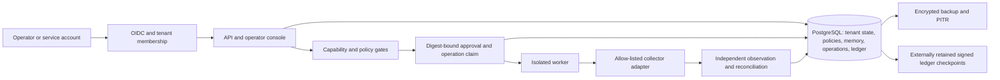

# MAESTRO enterprise reference system — design for discussion

Date: 30 October 2026. User direction: enterprise-ready system; engineering
choices delegated to the agent. Status: researched design, **not implemented**.
Baseline: `fb1425235417879e1af227e691a3676ccedd68c0`.

This design supersedes the October 24 roadmap's target and sequencing for the
enterprise path. It preserves that audit and its evidence. The decisions below
are engineering choices made under the user's delegation, not customer research
results. Sources and code findings are in the
[research report](../../research/2026-10-30-enterprise-readiness-research.md).

## Target and limits

Deliver a reproducibly installed, self-hosted system in which an authenticated
operator can review a SOC alert, approve a bounded action, observe its verified
effect, and reconstruct or recover that decision after a failure.

Reference profile: Linux x86-64; Python 3.13 runtime; supported package floor
Python 3.12 after compatibility migration; PostgreSQL 18; TLS ingress; enrolled
OIDC identity provider; API and isolated execution worker; encrypted backup and
artifact storage under distinct administrative permissions. Pin actual minor
versions/image digests during implementation; floating tags are not release IDs.
Use a pinned Keycloak fixture to exercise the protocol in integration CI. That
fixture does not prove compatibility with every commercial identity provider.

Retain the existing modular monolith and its capability/policy enforcement
concepts. No Kubernetes, HA cluster, Redis or Temporal requirement in this first
profile. Run one primary worker initially; test two workers racing on the same
operation to prove the claim protocol. Availability expectations must disclose
the single-node dependencies. Additional deployment profiles are separate work.

No simulated adapter is admitted as production-capable. Hybrid mutation,
arbitrary code execution, autonomous public Git actions and autonomous research
reports are disabled in the enterprise profile until their own acceptance gates
pass. Offline reproduction remains a separate development/research mode.

## First supported workflow

Use the existing SOC/network-monitoring domain. In the reference environment:

1. Ingest a signed/authenticated alert with a stable unique event ID and a known
   telemetry-source identity; scope its records to the tenant/agent.
2. The reasoner proposes an allow-listed bounded response. The independent
   network verifier, capability and policy checks still govern execution.
3. An operator reviews the evidence, intended target, effect limits and expiry.
   Approval authorizes that digest only; it does not grant a general tool token.
4. An allow-listed first-party adapter applies a time-bounded telemetry-rate
   configuration to a designated test collector in the reference environment.
5. A separate observer measures the collector's emitted rate and high-priority
   event delivery, verifies the configured limit, then verifies expiry/recovery.
6. Persist the receipt, verification outcome and ledger events. On uncertain
   completion, stop and reconcile; never replace observation with `ok=True`.

The test collector must emit real messages and apply the actual rate behavior;
a stub response is insufficient. Changing an organization's live monitoring
configuration is a separate deployment authorization, not part of these tests.
Success requires preserving priority/security events, not merely reducing load.
Customer usefulness remains to be validated; this is the smallest workflow that
reuses the existing domain and tests a real, bounded effect.

## State and trust architecture

### Tenant and identity authority

Use Authlib for the login flow and a maintained JOSE validator for API tokens.
Discover only operator-enrolled issuers, validate issuer/resource audience,
signature algorithm, expiry, state/nonce/PKCE where applicable, and bound JWKS
refresh. No user-provided discovery URL or tenant field can expand authority.
Unknown identity/tenant membership is denied, not mapped into `default`.

Browser session is an opaque HttpOnly/Secure/SameSite cookie backed by a durable
server session; use CSRF protection on cookie-authenticated mutations. Store
provider tokens server-side under encryption, not browser localStorage. Service
accounts receive separately scoped, revocable credentials. MFA is an IdP policy
for privileged roles and is verified during the reference-provider acceptance.

Tenant lifecycle is ACTIVE → CONTAINED → ACTIVE (explicit privileged release),
with DISABLED for decommissioning. Persist every transition. Creation, reset,
resume, capability issuance, approval and execution consult authoritative tenant
state. Isolation applies to future agents as well as existing ones. Deletion
creates tombstones and retention decisions, not silent erasure of audit history.

Put tenant/agent context on the same database transaction/connection as the
queries. RLS covers scoped rows; application role cannot own protected tables or
bypass RLS. No autonomous worker receives direct database credentials. Document
that RLS does not constrain a database superuser or arbitrary SQL under the
trusted app role. Administrative cross-tenant access uses a separate explicit,
audited operation and never an agent-settable session flag.

### Durable actions and approvals

An operation record binds `operation_id`, tenant, actor, proposal/argument digest,
policy digest, approval ID, adapter/version, timestamps and expected effect.
Enforce uniqueness in the database, and atomically claim eligible work. A changed
payload under the same ID conflicts. An approval binds the same tuple, has an
expiry, is consumed according to that operation, and cannot be reused across
tenant, actor or policy changes. Privileged policy changes require distinct
authenticated approvers. No count of self-supplied signatures substitutes for it.

Operation states: PROPOSED → AWAITING_APPROVAL → READY → RUNNING →
SUCCEEDED/FAILED/UNKNOWN; DENIED/CANCELLED are pre-effect terminal results.
UNKNOWN can move only through audited reconciliation to SUCCEEDED or FAILED.
RUNNING whose worker disappears becomes UNKNOWN, not automatically READY.
SUCCEEDED requires a recorded independent observation. Compensation is a
separate authorized operation, and never asserted as a universal rollback.

Check current tenant/authorization/policy state immediately before dispatch.
Containment commits and dispatch claims must use the same per-tenant locking
order, so no new claim succeeds after containment commits. A claim already
RUNNING may have sent its effect: request cancellation, mark uncertainty and
reconcile. Do not promise that containment can retract an in-flight network call.
Worker leases/epochs prevent stale local claims from completing state updates;
external adapters need their own idempotency/fencing or reconciliation contract.

### Signing and ledger guarantees

Keep authorization evidence separate from signatures. Verify artifact digests
against a configured public-key trust store, initially using Cosign's key-based
profile. Protect private keys outside serialized policy/signature records.
Record signer IDs and key versions; rotation must preserve historical verification.
Production startup rejects missing secrets, unknown trust roots, simulated gates,
unsupported adapter/runtime profiles and absent required services.

Order ledger appends transactionally per tenant and preserve canonical event
hashes. Restrict updates/deletes and anchor signed chain-head/checkpoint manifests
outside the database's administrative domain. State the guarantee honestly:
tamper evidence against unauthorized changes under this trust model, not
immutability against a party controlling both the database and all signing keys.

### Recovery admission

A restore starts in a globally contained recovery mode under a new recovery
epoch. Restored pending approvals and old worker leases cannot authorize new
effects. Reconcile possibly executed operations against the adapter's retained
operation IDs/observed state, including work newer than the selected restore
point. Preserve the old evidence and issue fresh approvals only after explicit
recovery release. A restored database being internally consistent does not prove
that external effects have been rolled back. The backup manifest must bind the
database recovery point, required evidence objects and key versions; do not
resume if any required part is unavailable.

## Delivery phases and gates

| Phase | Deliverable | Required exit evidence |
|---|---|---|
| **E0 — Release truth and supported build** | Correct offline validator, regression cases for audit failures, type/interface repairs, supported runtime and clean wheel/image | Required checks propagate failure; no fake release-ready outcome; full suite/lint/types green on the selected supported matrix; clean-install resources/scripts work |
| **E1 — Durable authority and execution** | PostgreSQL migrations/stores, tenant lifecycle, operation claims, receipts, safe retries, persisted governance | Restart/race/cross-tenant tests; UNKNOWN blocks blind resend; new-agent containment gap closed; no key self-trust |
| **E2 — Identity and deployment boundary** | Enrolled OIDC, sessions/service accounts, real resource-server checks, isolated worker, signed artifacts | Real provider key rotation/logout tests, Linux confinement/egress tests, production boot rejection cases |
| **E3 — Recovery and operations** | PITR/restore, retained evidence, operator console and approval inbox, health/metrics/alerts, quotas | Clean-target recovery and key recovery; tenant-scope UI/WS tests; actionable failure alerts and audited approvals |
| **E4 — Release candidate evaluation** | One observed SOC workflow, load/soak/upgrade tests and independent review | Positive task completion plus adversarial denials; signed evidence bundle; measured SLO/recovery results; bounded pilot report |

E0 is the next development phase. Its success is a reliable, supported foundation;
it does not by itself make the system enterprise-ready. E1–E4 each need a small
implementation plan before coding their subsystem, using this design as the
constraint set. See [the to-do list](../../ENTERPRISE_TODO.md).

## Acceptance contract for the reference release

These numbers are engineering test targets, not measured results or contractual
SLAs. Change them only with a recorded rationale and matching test updates.

- **Correctness:** all applicable offline and required integration checks pass;
  no required service/profile silently skips. Each original audit defect has
  regression evidence or an explicitly disabled production feature.
- **Tenant security:** cross-tenant read/write/approval/WS/export attempts are
  denied; contained tenants cannot acquire new execution authority; a two-worker
  same-ID race produces one effect or an explicit UNKNOWN outcome, never a
  falsely verified duplicate success.
- **Identity:** one real enrolled provider passes login/PKCE, issuer/audience,
  key rotation, expiry, logout/session revocation and role/membership tests.
- **Recovery:** proposed RPO ≤15 minutes and RTO ≤60 minutes for the named
  reference dataset; prove a point-in-time restore onto a fresh target. Record
  dataset size, backup cadence, hardware and key recovery separately. Unproven
  targets block the readiness claim; earlier 1-minute/5-minute claims are retired.
- **Load:** initial fixture has 10 tenants, 100 agents, 20 concurrent clients and
  10 operation submissions/second for 30 minutes. Target p95 API acknowledgement
  ≤1 second, excluding model/tool completion. Persisted audit writes must be
  enabled. Report actual results and bottlenecks; do not publish an availability
  SLA from this test.
- **Recovery behavior:** worker/API/DB connection loss, disk-full and response
  loss tests never turn uncertainty into verified success. Restart restores
  contained tenants, pending approvals, operation state and audit continuity.
- **Usefulness:** evaluate at least 30 benign SOC tasks and 30 attack variants;
  target ≥90% benign completion, zero unauthorized effects in that fixed corpus,
  and publish denominators/held-out results. Small samples do not establish
  general attack resistance.
- **Operations:** liveness differs from readiness; dependency failure makes
  readiness fail. Alert on invalid signatures, ledger failure, UNKNOWN backlog,
  backup lag, sustained denials and quota exhaustion. Redact secrets and sensitive
  payloads from logs/traces/exports; maintain a key/credential rotation runbook.
- **Delivery:** verified clean installation, signed image/wheel digests, SBOM,
  reviewed dependency/image findings, upgrade/rollback compatibility rehearsal,
  ASVS applicability/evidence mapping, and independent review with no unresolved
  critical/high release blockers. These are release requirements, not proof of
  certification.

## Explicit product decisions

The first enterprise features are durable containment, operation receipts,
approval inbox, identity/tenant membership, policy diff/shadow replay, recovery,
and a readiness/evidence view. Prioritize them over adding more agent types.
Retain existing UI shells where useful, but shared authentication and truthful
error/status handling are mandatory. Review the final flows in a browser after
implementation.

Default retention for the reference profile is 90 days of audit/decision
metadata and 30 days of raw input/evidence payload, configurable by the operator.
The retention job must preserve manifests needed to interpret remaining records,
honor deletion holds and audit its own actions. These defaults are engineering
choices, not legal advice or a commitment to a particular regulatory regime.

No further product-choice question is needed to prepare E0. Before a customer
deployment, actual infrastructure credentials, permitted targets, data policies
and organizational acceptance remain deployment inputs. Planning can proceed
without accessing or guessing them.
